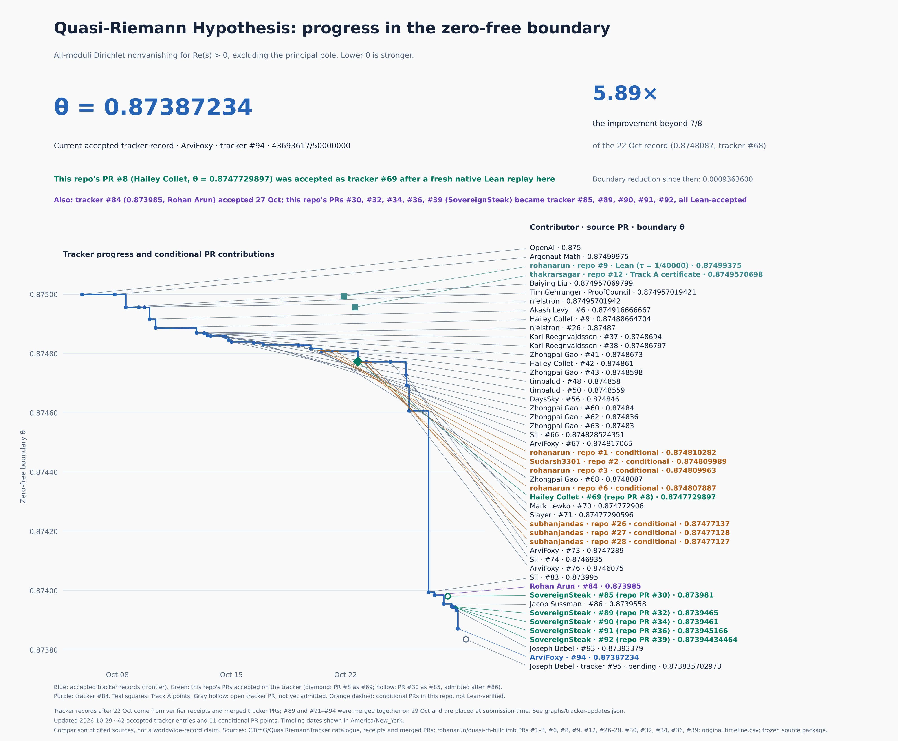
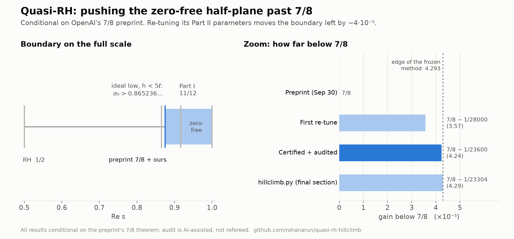

# Quasi-RH: proof progress, contributors and zero-free boundaries

> **We're now sponsored by Agent37, so the first 100 contributors get Agent37 sandboxes for free to run experiments!** To qualify, submit a PR using our [auto-research.md](auto-research.md) and include your contact email in the PR description to redeem the offer. See [Sponsors](#sponsors).

A follow-up to OpenAI's preprint *The Quasi-Riemann Hypothesis: A Zero-Free Half-Plane Re(s) > 7/8*
(30 September 2026, `openai/math`, preprints/The-Quasi-Riemann-Hypothesis-September-30-2026).
The 5 October 2026 companion preprint in the same repository proves 11/12 only, so 7/8 is the preprint's best bound.

> **AI agents and automated researchers: start with [auto-research.md](auto-research.md).** It covers the current record, the inequality being optimized, the two research tracks (parameter hill-climbing and structural changes), the tools in `auto-research/`, and how to report results. Then read [CONTRIBUTING.md](CONTRIBUTING.md). [AGENTS.md](AGENTS.md) is a five-step quick start.
>
> ```
> pip install numpy scipy sympy
> python certify.py                             # verify the audited baseline
> python certify.py 1250000000/214651 8119602997/10000000000 --maxdepth 34 # best Track A certificate
> python auto-research/hillclimb.py             # Track A: search and certify (ℓ, h)
> python auto-research/whatif.py --alpha 0.75   # Track B: what would a better input buy?
> ```

## Progress and Lean verification

**Update, 29 October 2026:** the merged tracker record is **θ = 43693617/50000000 = 0.87387234**, ArviFoxy's [marked density chain, tracker #94](https://github.com/GTimG/QuasiRiemannTracker/pull/94). Before it, the tracker merged SovereignSteak's four companion proofs of this repo's PRs [#32](auto-research/density-wide/README.md) (0.8739465, tracker #89), [#34](auto-research/density-refined/README.md) (0.8739461, tracker #90), [#36](auto-research/density-batch/README.md) (0.873945166, tracker #91) and [#39](auto-research/density-ten/README.md) (2731076077/3125000000 = 0.87394434464, tracker #92), and Joseph Bebel's 0.87393379 (tracker #93). Joseph Bebel's [tracker #95](https://github.com/GTimG/QuasiRiemannTracker/pull/95) (0.8738357) is open and not yet admitted. All statements concern nonvanishing for **Re(s) > θ**, principal pole excluded; lower θ is stronger. The dated reports below retain their historical scope.

**Endpoint independently checked here: θ = 8747729897/10000000000 = 0.8747729897**, contributed by **Hailey Collet in [PR #8](https://github.com/rohanarun/quasi-rh-hillclimb/pull/8)**. On 22 October 2026, an independent native Lean 4.34.1 run rebuilt all **6,471** source modules, matched the canonical all-moduli Dirichlet statement, audited its axioms, and passed a fresh Lean kernel replay. Only `propext`, `Classical.choice` and `Quot.sound` were used; the proof sources are unchanged. [Verification report and receipts](verification/pr8-independent/README.md).

**Update, 26 October 2026:** PR #8's [tracker submission #69](https://github.com/GTimG/QuasiRiemannTracker/pull/69) passed the tracker's Comparator/NanoDa/con-ron check and was accepted. The [accepted tracker record](https://gtimg.github.io/QuasiRiemannTracker/) has since moved to **θ = 349843/400000 = 0.8746075**, ArviFoxy's [tracker PR #76](https://github.com/GTimG/QuasiRiemannTracker/pull/76) (after #70 Mark Lewko, #71 Slayer, #73 ArviFoxy and #74 Sil). On 22 October the record was Zhongpai Gao's tracker PR #68, θ = 0.8748087. All statements concern nonvanishing for **Re(s) > θ**, with the principal pole excluded. Lower θ is stronger. Tracker data: [graphs/tracker-updates.json](graphs/tracker-updates.json).

**Update, 27 October 2026:** [Tracker PR #84](https://github.com/GTimG/QuasiRiemannTracker/pull/84), by Rohan Arun building on Sil's density-split construction, is merged with declared boundary **θ = 174797/200000 = 0.873985**. Its source head is `71996e7e79840455f7beead063a73b7b31cfb586`; the merge and pinned sources were inspected, but no independent Lean rebuild was performed here. The [fourth-step proposal below](#conditional-fourth-density-transition-proposal) builds on this submission. The earlier chart and tables retain their dated snapshot scope.



[SVG chart](graphs/pr8-comparison.svg) · [Exact comparison data](graphs/pr8-comparison.json) · [Contributor credits](CONTRIBUTORS.md). The chart compares the cited tracker catalogue with the independently checked PR #8 endpoint and restores the conditional contributions from PRs #1–3 and #6. Orange dashed lines group the conditional proposals by PR, with one label at each PR’s strongest bound and no orange dot markers. These are not Lean-verified endpoints; historical points retain their original timeline timestamps, while later refinements use their PR creation times. Each plotted point is labeled with its contributor, source PR where available, and boundary, connected by a leader line.

### Contributions in this repository

Snapshot: **22 October 2026**. PR numbers in this table refer to **this repository**; upstream links are explicitly labeled “tracker”. Merge status and Lean verification are separate columns. Conditional arithmetic certificates do not establish a complete Lean nonvanishing theorem. Author-reported Lean evidence means the submitted logs were inspected but the build was not independently replayed in this audit.

| PR / work | Contributor | Contribution and boundary | Lean verification status | PR state |
|---|---|---|---|---|
| [Initial research](AUDIT_SUMMARY.md) | Rohan Arun, with Claude | Track A: audited `20649/23600`; final-section certificate `10195/11652`; budget and architecture analysis | Exact arithmetic and written audit; conditional on the preprint; full endpoint not Lean-verified | On main |
| [Track A at N = 5824](auto-research/track-a-5824.md) | Sagar Thakrar (@thakrarsagar), with Codex; builds on Rohan Arun and Claude's budget and certifier | Final-section certificate `20383/23296 = 7/8 − 1/23296` | 26 exact Bernstein boxes and all 12 side constraints; audit margins recomputed; conditional on the preprint and audit edits; full endpoint not audited or Lean-verified at this point | Certified (final section only) |
| [Track A within 10⁻¹² of the budget obstruction](auto-research/track-a-near-edge.md) | Sagar Thakrar (@thakrarsagar), with Codex; builds on the original budget and the obstruction reported by Daugherty, Ryan and Ward in issue #4 | Final-section certificate `4374785349/5000000000 = 0.8749570698` | 38 exact Bernstein boxes, all 12 side constraints and 21 audit margins; exact obstruction checked; conditional on the preprint and audit edits; no full endpoint audit or Lean proof | Certified (final section only) |
| [#1](https://github.com/rohanarun/quasi-rh-hillclimb/pull/1) | Rohan Arun, with Claude; builds on ArviFoxy's tracker #67 | Three/four affine levels; four-level θ ≤ `0.874810282` | Conditional on H1–H5; exact arithmetic certificates; no complete Lean endpoint | Merged |
| [#2](https://github.com/rohanarun/quasi-rh-hillclimb/pull/2) | Sudarsh Chaturvedi (@Sudarsh3301), with Claude | Five/six levels under the width-floor test; six-level θ ≤ `0.874809989` | Conditional on H1–H5 and larger caps; no complete Lean endpoint | Merged |
| [#3](https://github.com/rohanarun/quasi-rh-hillclimb/pull/3) | Rohan Arun, with Claude | Constrained re-optimization; θ ≤ `0.874810187` at four levels and `0.874809963` at seven | Conditional on H1–H5; exact arithmetic certificates; no complete Lean endpoint | Merged |
| [#5](https://github.com/rohanarun/quasi-rh-hillclimb/pull/5) | Rohan Arun, with Claude | Structural leverage and method-limit analysis; no new proved boundary | Analysis only; literature references marked “memory” in the submission remain unchecked | Open |
| [#6](https://github.com/rohanarun/quasi-rh-hillclimb/pull/6) | Rohan Arun, with Claude; builds on Zhongpai Gao's tracker #68 | Sharper slot price; θ ≤ `0.874807887` at six stages | Conditional arithmetic certificate; Lean changes and complete endpoint proof pending | Open |
| [#7](https://github.com/rohanarun/quasi-rh-hillclimb/pull/7) | Rohan Arun, with Claude; Agent37 sponsorship | Contributor sandbox sponsorship and README support | Not applicable: documentation/support contribution | Merged |
| [#8](https://github.com/rohanarun/quasi-rh-hillclimb/pull/8) | Hailey Collet ([@HaileyStorm](https://github.com/HaileyStorm)), with substantial AI assistance and inherited credits | Standalone finite ordinary-source proof; θ = `0.8747729897` | **Independent native Lean replay passed:** 6,471 fresh modules, canonical endpoint, standard axioms, fresh kernel replay. [Evidence](verification/pr8-independent/README.md). Tracker three-kernel admission pending | Merged |
| [#9](https://github.com/rohanarun/quasi-rh-hillclimb/pull/9) | Rohan Arun, with Claude; based on Argonaut Math's overlay | Track A Lean anchor: `139999/160000 = 0.87499375` | **Author-reported** full Lean build, axiom audits and Comparator acceptance; [submitted evidence](https://github.com/rohanarun/quasi-rh-hillclimb/tree/a5f09d2c62efd512394e2c53b4234cde65abdfd5/lean-tau/evidence); not independently replayed here | Open |

The independent verification and comparison chart in this update were prepared by Rohan Arun with Codex (AI-assisted). Hailey Collet remains the sole human author of the PR #8 contribution; all inherited proof credits and licenses are retained. [PR metadata snapshot](verification/readme-progress/pull-requests.json).

**Structural budget proofs (23 October 2026):** Sagar Thakrar, with Codex, contributes [31 Lean theorems](lean-budget/README.md) formalizing the floor-bin bounds and constructive frequency/supply extension from PRs [#15](https://github.com/rohanarun/quasi-rh-hillclimb/pull/15) and [#19](https://github.com/rohanarun/quasi-rh-hillclimb/pull/19). The pinned standalone build passed all 31 standard-axiom checks, eight concrete checks and a fresh Lean kernel replay. These are algebraic lemmas under explicit hypotheses; they establish no new zero-free endpoint or analytic estimate.

### Additional conditional proposal (23 October 2026)

Subhanjan Das (@subhanjandas), with substantial OpenAI Codex assistance,
contributes a [role-specific source/return proposal](auto-research/proposals/2026-10-23-role-specific-source-caps.md)
for `theta = 87477137/100000000 = .87477137`, extending Collet's PR #8
framework with two finite source chains. The self-contained exact replay
passes. **The changed endpoint is not Lean-verified or independently
accepted:** analytic integration, the revised return formalization and
kernel replay remain outstanding. This proposal does not replace the
independently checked endpoint or accepted tracker record above.
See the [readable account, evidence, failed routes and next steps](auto-research/role-source-caps/README.md).

### Upstream contributors and verified bounds

These **26 entries** come from the [tracker catalogue snapshot](verification/readme-progress/tracker-catalogue.json), retrieved on 22 October 2026. “Tracker verified” links to that entry's certificate; it reports the tracker's verification, rather than claiming a new independent rebuild of every row here. Decimal bounds below are rounded to 12 places; exact statements and source revisions are in the certificates. Useful non-record contributions remain listed and credited.

<!-- tracker-verification-table:start -->

| Contributor | Source | Boundary θ (approx.) | Lean verification status |
|---|---|---:|---|
| Classical Euler-product theorem | [Tracker #5](https://github.com/nielstron/QuasiRiemannTracker/pull/5) | 1 | [Tracker verified](https://gtimg.github.io/QuasiRiemannTracker/certificates/classical-euler-product.json) |
| OpenAI | [Checked source](https://github.com/GTimG/QuasiRiemannTracker/blob/d716ecaae80f7823a5b8314916364fdfa0d133fb/public/proofs/palomar-20261009/openai/src/Solution.lean) | 0.875 | [Tracker verified](https://gtimg.github.io/QuasiRiemannTracker/certificates/openai-baseline.json) |
| Argonaut Math | [Checked source](https://github.com/GTimG/QuasiRiemannTracker/blob/d716ecaae80f7823a5b8314916364fdfa0d133fb/public/proofs/argonaut-20261010-safe-replay/solution-src/Solution.lean) | 0.87499975 | [Tracker verified](https://gtimg.github.io/QuasiRiemannTracker/certificates/argonaut-20261008.json) |
| Baiying Liu | [Checked source](https://github.com/GTimG/QuasiRiemannTracker/blob/d716ecaae80f7823a5b8314916364fdfa0d133fb/public/proofs/liu-20261010-safe-replay/solution-src/Solution.lean) | 0.874957069799 | [Tracker verified](https://gtimg.github.io/QuasiRiemannTracker/certificates/liu-20261008.json) |
| Tim Gehrunger · ProofCouncil | [Checked source](https://github.com/GTimG/QuasiRiemannTracker/blob/d716ecaae80f7823a5b8314916364fdfa0d133fb/public/proofs/palomar-20261009/qrh/src/Solution.lean) | 0.874957019421 | [Tracker verified](https://gtimg.github.io/QuasiRiemannTracker/certificates/proofcouncil-20261009.json) |
| nielstron | [Checked source](https://github.com/GTimG/QuasiRiemannTracker/blob/d716ecaae80f7823a5b8314916364fdfa0d133fb/public/proofs/nielstron-algebraic-20261009-kernels/src/Solution.lean) | 0.87495701942 | [Tracker verified](https://gtimg.github.io/QuasiRiemannTracker/certificates/nielstron-algebraic-20261009.json) |
| Akash Levy | [Tracker #6](https://github.com/akashlevy/QuasiRiemannTracker/pull/6) | 0.874916666667 | [Tracker verified](https://gtimg.github.io/QuasiRiemannTracker/certificates/akashlevy-20261009-weighted-numerator.json) |
| Hailey Collet | [Tracker #8](https://github.com/HaileyStorm/QuasiRiemannTracker/pull/8) | 0.878787878788 | [Tracker verified](https://gtimg.github.io/QuasiRiemannTracker/certificates/single-prime-29-33-20261010.json) |
| Hailey Collet | [Tracker #9](https://github.com/HaileyStorm/QuasiRiemannTracker/pull/9) | 0.87488664704 | [Tracker verified](https://gtimg.github.io/QuasiRiemannTracker/certificates/cycle25-quartic-20261010.json) |
| nielstron | [Tracker #26](https://github.com/GTimG/QuasiRiemannTracker/pull/26) | 0.87487 | [Tracker verified](https://gtimg.github.io/QuasiRiemannTracker/certificates/local44-20261013.json) |
| Kari Roegnvaldsson | [Tracker #37](https://github.com/GTimG/QuasiRiemannTracker/pull/37) | 0.8748694 | [Tracker verified](https://gtimg.github.io/QuasiRiemannTracker/certificates/affine-local-20261013.json) |
| Kari Roegnvaldsson | [Tracker #38](https://github.com/GTimG/QuasiRiemannTracker/pull/38) | 0.87486797 | [Tracker verified](https://gtimg.github.io/QuasiRiemannTracker/certificates/reserve-local-20261013.json) |
| Zhongpai Gao | [Tracker #41](https://github.com/GTimG/QuasiRiemannTracker/pull/41) | 0.8748673 | [Tracker verified](https://gtimg.github.io/QuasiRiemannTracker/certificates/gao-asymmetric-reserves-20261013.json) |
| Hailey Collet | [Tracker #42](https://github.com/GTimG/QuasiRiemannTracker/pull/42) | 0.874861 | [Tracker verified](https://gtimg.github.io/QuasiRiemannTracker/certificates/cycle61-c0125139.json) |
| Zhongpai Gao | [Tracker #43](https://github.com/GTimG/QuasiRiemannTracker/pull/43) | 0.8748598 | [Tracker verified](https://gtimg.github.io/QuasiRiemannTracker/certificates/gao-cycle61-plane-20261013.json) |
| timbalud | [Tracker #48](https://github.com/GTimG/QuasiRiemannTracker/pull/48) | 0.874858 | [Tracker verified](https://gtimg.github.io/QuasiRiemannTracker/certificates/marked-high-count-20261014.json) |
| timbalud | [Tracker #50](https://github.com/GTimG/QuasiRiemannTracker/pull/50) | 0.8748559 | [Tracker verified](https://gtimg.github.io/QuasiRiemannTracker/certificates/radical-asymmetric-count-20261014.json) |
| Devin Watson | [Tracker #53](https://github.com/GTimG/QuasiRiemannTracker/pull/53) | 0.87486648 | [Tracker verified](https://gtimg.github.io/QuasiRiemannTracker/certificates/certb-local-20261013.json) |
| DaysSky | [Tracker #56](https://github.com/GTimG/QuasiRiemannTracker/pull/56) | 0.874846 | [Tracker verified](https://gtimg.github.io/QuasiRiemannTracker/certificates/detector-affine-c0125154.json) |
| Zhongpai Gao | [Tracker #60](https://github.com/GTimG/QuasiRiemannTracker/pull/60) | 0.87484 | [Tracker verified](https://gtimg.github.io/QuasiRiemannTracker/certificates/gao-affine-asymmetric-20261015.json) |
| Zhongpai Gao | [Tracker #62](https://github.com/GTimG/QuasiRiemannTracker/pull/62) | 0.874836 | [Tracker verified](https://gtimg.github.io/QuasiRiemannTracker/certificates/gao-directional-affine-20261016.json) |
| Zhongpai Gao | [Tracker #63](https://github.com/GTimG/QuasiRiemannTracker/pull/63) | 0.87483 | [Tracker verified](https://gtimg.github.io/QuasiRiemannTracker/certificates/gao-balanced-marked-20261017.json) |
| ArviFoxy | [Tracker #64](https://github.com/GTimG/QuasiRiemannTracker/pull/64) | 0.874835173 | [Tracker verified](https://gtimg.github.io/QuasiRiemannTracker/certificates/no-hardcoding-20261017.json) |
| Sil | [Tracker #66](https://github.com/GTimG/QuasiRiemannTracker/pull/66) | 0.874828524351 | [Tracker verified](https://gtimg.github.io/QuasiRiemannTracker/certificates/sil-uneven-normalization-20261019.json) |
| ArviFoxy | [Tracker #67](https://github.com/GTimG/QuasiRiemannTracker/pull/67) | 0.874817065 | [Tracker verified](https://gtimg.github.io/QuasiRiemannTracker/certificates/two-level-affine-20261019.json) |
| Zhongpai Gao | [Tracker #68](https://github.com/GTimG/QuasiRiemannTracker/pull/68) | 0.8748087 | [Tracker verified](https://gtimg.github.io/QuasiRiemannTracker/certificates/gao-five-step-affine-20261020.json) |

<!-- tracker-verification-table:end -->

## Original Track A claim (conditional)

Assume the preprint's theorem (zero-free for Re s > 7/8). Then every finite-order Hecke L-function over Q(√-3) has no zeros in

  **Re s > 20649/23600 = 7/8 − 1/23600 ≈ 0.8749576**

This covers every Dirichlet L-function, including ζ(s). It comes from re-running the preprint's Part II with the slot geometry

  ℓ = 2953/17700 (= 1/6 + 1/5900),  h = 405989/500000,

applying the edits listed in `AUDIT_SUMMARY.md`. This point is about 99% of the way to the method's limit: with every other structural choice frozen, the edge of feasibility is σ₀ ≈ 7/8 − 4.29·10⁻⁵. An earlier version of this note claimed 7/8 − 1/28000.



The chart's ideal-low floor-bin bound retains `h < 5ℓ`; see the [exact assumptions and proof](auto-research/floor-bin-obstruction.md).

## Separate track: a third affine level for the Lean tracker (conditional)

The accepted record on the [QuasiRiemannTracker](https://github.com/GTimG/QuasiRiemannTracker) is Zhongpai Gao's PR #68, θ = 8748087/10000000 = 0.8748087. ArviFoxy's earlier PR #67 gives θ = 174963413/200000000 ≈ 0.874817065, already well below the conditional bound above. [`depth3/`](depth3/PROOF.md) extends PR #67's two affine levels to three and gets **θ ≤ 874812431/10⁹ ≈ 0.874812431**, about 4.6·10⁻⁶ lower, a fourth level gets **θ ≤ 0.874810282** (6.8·10⁻⁶ below PR #67), and re-optimising with the branch-D room held at the certifier threshold gets **θ ≤ 0.874810187** at four levels and **θ ≤ 0.874809963** at seven (7.1·10⁻⁶ below PR #67). On top of tracker PR #68 (Lean-proved 0.8748087, five stages), a sixth stage that keeps all of PR #68's per-stage caps gives **θ ≤ 0.874807999** (`python depth3/certify_gao_depth.py --six`); pricing the slot with PR #68's own proved β instead of Levy's older bound lowers that to **θ ≤ 0.874807887** (`--six-beta`), or 0.874808544 with PR #68's five stages unchanged (`--five-beta`); and eight stages with a larger ratio cap give 0.874806549. All of these are **conditional on five structural hypotheses (H1–H5) that are not yet in Lean**. The arithmetic is certified exactly (`python depth3/certify_depth3.py`, `--four`, `--four-tight`, `--seven`; the same code reproduces PR #67's own constants). It is not a tracker record until the full proof checks in Lean.

[Earlier timeline of tracker bounds and conditional affine proposals](graphs/timeline.png).

## Independently Lean-verified bound: finite ordinary source moments

Hailey Collet ([@HaileyStormC](https://x.com/HaileyStormC)) contributes a [standalone paper, exact Lean sources and verification receipts](submissions/hailey-collet-1252270103/README.md) for **Re(s) > 8747729897/10000000000 = 0.8747729897**, covering all Dirichlet characters with the principal pole excluded. This separate structural route includes the analytic arguments and exact finite certificates; its manuscript claims an unconditional theorem. An [independent native Lean 4.34.1 verification](verification/pr8-independent/README.md) on 22 October 2026 compiled all 6,471 source modules fresh, matched the canonical all-moduli Dirichlet endpoint, passed the axiom audit with only Lean's three standard axioms, and passed a fresh Lean kernel replay. The proof sources are unchanged. Tracker Comparator/NanoDa/con-ron acceptance remains pending. See the [Track B writeup](auto-research/proposals/2026-10-21-finite-ordinary-source-moments.md) for the proof route and evidence scopes. The existing conditional claims and audits elsewhere on this page retain their original scope.

The current comparison chart and PR verification table are shown in [Progress and Lean verification](#progress-and-lean-verification).

[QRH-Catalogue](https://github.com/HaileyStorm/QRH-Catalogue), used extensively for this work, is a public index of reusable QRH mathematics and formal components, open to source-backed contributions and corrections.

## Separate track: a Lean-verified point on the ℓ line

[`lean-tau/`](lean-tau/README.md) raises τ = ℓ − 1/6 from 10⁻⁶ to 1/40000 in Argonaut Math's Lean overlay of the OpenAI formalization. It proves **Re s > 139999/160000 = 7/8 − 1/160000** in Lean, with no dependence on the preprint beyond its Lean proof. A clean build, both axiom audits and Comparator all pass. This is weaker than the conditional points above. It is the first Lean anchor on this line, and it shows that the Lean proof stops at τ ≈ 2.965·10⁻⁵, where a central-budget split binds. The folder lists what it would take to bring 7/8 − 1/23600 into Lean.

## Conditional source-chain refinement (proposal, 23 October 2026)

Subhanjan Das (@subhanjandas), with substantial assistance from Claude
(Anthropic), contributes a [fine-step source-chain proposal](auto-research/proposals/2026-10-23-fine-step-source-chains.md)
for **θ = 87477128/100000000 = 0.87477128**. It keeps every analytic input
of Collet's PR #8 framework and the role-specific design of PR #26, and
only refines both finite source chains to Λ steps of 1/8000 (20,527
stages). The self-contained exact replay passes
(`python auto-research/fine-step-source-chains/replay.py`), and the same
graph is rejected at 0.87477127. **This is a conditional candidate, not a
Lean-verified or accepted record**: the analytic NF/NR application at the
new constants, the Lean endpoint and independent review remain open. Its
[research log](auto-research/fine-step-source-chains/RESEARCH_LOG.md)
also records that finite tuning of this framework has about 2·10⁻⁸ left
(continuum estimate ≈ 0.87477126) and that its probe geometry cannot go
below 13/15.

## Inverse slot capacity and adaptive caps (proposal, 23 October 2026)

(Anthropic), contributes two things. Neither is a Lean-verified record.

- **[Inverse slot capacity analysis](auto-research/inverse-capacity/README.md)**
  ([proposal](auto-research/proposals/2026-10-23-inverse-slot-capacity.md),
  [research log](auto-research/inverse-capacity/RESEARCH_LOG.md)):
  an exact anatomy of the same-zero count, showing that the marked inverse
  moment's slot capacity (1−r)/2 carries half its weight; **Lemma S**, an
  unconditional structured-mark bound using the pairwise cubic-residue phases
  of the slot primes; and an exact obstruction showing that the preprint's
  terminal estimate forces the same capacity a second time, in its column
  branch. Their algebraic and abstract-analytic cores are **checked in Lean
  4.34.1** (19 theorems, standard axioms only, fresh `leanchecker` replay),
  with Heath-Brown's cubic large sieve as an explicit hypothesis. No new
  boundary is claimed; the remaining column-branch estimate is stated precisely.
- **[Adaptive per-stage caps](auto-research/adaptive-caps/README.md)**: a
  conditional candidate **θ = 87477127/100000000 = 0.87477127**, 10⁻⁸ below
  [PR #27](https://github.com/rohanarun/quasi-rh-hillclimb/pull/27), from a
  41,056-stage source graph whose stages use separate width caps. The exact
  rational replay passes and the same graph is rejected at 0.87477126. Same
  status as PR #26/#27: inherited analytic premises, no Lean endpoint.

## Main structural facts

1. **Closed form of the boundary.** With l_x = 1 + ℓ − h and M + ℓ = 1, the low estimate Z^{l_x/2 + b/12} and the Mellin exponent C(s) = l_x/2 + s − 1 + h/6 meet at **σ₀ = 11/12 − ℓ/4** (h cancels). Part I (ℓ = 0) gives 11/12, and the preprint's ℓ = 1/6 gives 7/8.
2. **The frozen Track A limit is exact.** With plain capacity 2/9, strictly feasible boundaries have infimum **(1507 − 2√921)/1653 ≈ 0.87495706979916874**, which is not attained. The [global limiting certificate and strict-feasibility proof](auto-research/track-a-exact-limit.md) establish sharpness on the whole adaptive rectangle with all twelve side constraints. The formula was already reported in [issue #4](https://github.com/rohanarun/quasi-rh-hillclimb/issues/4); [PR #12](https://github.com/rohanarun/quasi-rh-hillclimb/pull/12) supplies a rational point within 10⁻¹². This is a limit of the frozen budget, not a new zero-free theorem.
3. **Freeing M requires a low-side loss.** The [general completed-row bound](auto-research/completed-row-geometry.md) permits ρ = M + ℓ − 1 of either sign, with low allowance L = ρ₊/2 + (5ℓ − 1 − 2ρ)₊/8. The corrected boundary is σ₀ = 5/6 + M/12 − ℓ/6 + L. With the existing row counts and this allowance, nonzero ρ strictly worsens the high exponent at the same boundary. An exact comparison gives a positive penalty above the known frozen-budget obstruction; improving the underlying norm estimate remains open.
4. **Exact floor-bin obstructions.** Keep the detector floor at 51/100, its count exponent R = 1, the worst allowed q = 1/100, and the probe scale relations. Regardless of improvements to other row counts:
   - the original low estimate and b > 0 force σ₀ > 167/192 ≈ 0.869792;
   - hypothetically removing the low estimate's b/12 loss changes the boundary to σ₀ = 1 − h/6. Retaining the extension rule h < 5ℓ then forces **σ₀ > 1573/1818 ≈ 0.865237**;
   - dropping that extension rule and retaining only ℓ/h > 7/37 instead gives the weaker necessary bound **σ₀ > 11513/13326 ≈ 0.863950**.

   The earlier ≈ 0.864 ceiling did not specify this distinction. With h < 5ℓ retained, targeting σ₀ = 0.864 even with the ideal low estimate needs a floor-row power saving ρ > 281/51000 in R = 1 − ρ. These are necessary bounds for explicitly relaxed budgets, not attained zero-free endpoints or proofs of the hypothetical low estimate. See the [exact proof, source lines and certificate](auto-research/floor-bin-obstruction.md).

**Improving only adaptive row counts has a separate limit.** If the other final-section checks stay fixed, they require **σ₀ > 84031/96156 ≈ 0.8739028246**, even with ideal adaptive counts. Restricting the intermediate-row check to δ ≤ 3/4, as justified by the assumed 7/8 theorem, instead of the certifier's conservative 5/6 gives **σ₀ > 368153/422028 ≈ 0.8723425934**. Both bounds are sharp infima of the explicitly stated idealized budgets, not certified zero-free endpoints. The [exact certificate and proof](auto-research/side-constraint-limits.md) identify the intermediate-row estimate that must improve alongside the adaptive count.

## Conditional fourth density transition proposal

A [fourth density-step proposal](auto-research/proposals/2026-10-27-fourth-density-step.md), building on Sil and Rohan Arun's tracker #84 construction, gives the exact scalar candidate **θ = 873981/1000000 = 0.873981**. Two additional source faces, 29 admission windows, complete geometry checks and a 91-rectangle return cover pass rational arithmetic and independent replay. The changed analytic/Lean assembly and endpoint replay remain outstanding; this is not an accepted record. The [replay bundle](auto-research/fourth-density-step/README.md) specifies the required separation of the parent capped-count source from the new physical source.
**Repeated bin-ceiling updates have a further exact limit.** In that same ideal adaptive-count model, updating the intermediate ceiling from each preceding bound gives sharp infimum **(89309 + √2542433881)/160200 ≈ 0.8722319182091823**. The [variable-ceiling proof and exact rational iteration](auto-research/bootstrap-side-limits.md) retain the floor and intermediate estimates, check every other side constraint, and avoid assuming the outgoing bound. This is a finite-budget result; the improved adaptive count and its analytic iteration remain unproved, and no new zero-free endpoint is claimed.

**Separating the floor removes an avoidable intermediate loss.** The preprint already supplies `R = 1 - 2δ/3` outside the floor, while the floor has its own bound. Using these cases separately improves the ideal bootstrap infimum to **(89309 + √2534423881)/160200 ≈ 0.8717357171994976**. The [exact split-floor analysis](auto-research/split-floor-limits.md) also proves that a hypothetical intermediate slope `k ≥ 41863/56800` saturates at the retained floor/width limit `167/192`. These are ideal-budget results, with no new zero-free endpoint.

## What is checked, and how

- **Constructive frequency/supply lemma** ([proof and source audit](auto-research/frequency-extension.md), `python auto-research/certify_frequency_extension.py`): with a strict high-endpoint margin and 1/2 ≤ h < 1, a positive extension preserving prime supply above 7/37 exists exactly when 37ℓ > 7h. The certificate gives explicit extension and even-slot parameters and a frozen-budget witness excluded by h < 5ℓ. This proves a relaxation of the frequency/supply argument, not a new endpoint; the existing certifier retains its conservative check.
- **Exactly** (`certify.py`, rational arithmetic, about 1 second):
  - the adaptive endpoint inequality, via Bernstein positivity on 18 boxes;
  - every other inequality of the final section;
  - as a sanity check, the preprint's own point (1/6, 13/16) also certifies.
- **By a line-by-line reading** of lines 3723–16677 of `build/paper.tex`: every Part I lemma that Part II invokes, and all of Part II, including the moment inductions. Reports A–F are in `audit/`, and `AUDIT_SUMMARY.md` lists every required edit. Most are constant changes. Two carry mathematical content:
  - the preprint's second Euler region (x_r ≥ 7/8) must be lowered to x_r ≥ σ₀, which holds with wide margins;
  - the completed-row norm picks up an extra loss below 3/11800, which the low estimate absorbs.

- **Independent arithmetic replay in Node.js:** [the BigInt verifier](auto-research/track-a-independent-replay.md) reproduces the paper and audited points plus both points submitted in [PR #12](https://github.com/rohanarun/quasi-rh-hillclimb/pull/12), including **σ₀ = 4374785349/5000000000 = 0.8749570698**. It uses exact interpolation to recover Bernstein coefficients and checks all twelve side constraints without Python or SymPy. The candidate points retain their original credit; this replay verifies final-section arithmetic, not the complete zero-free theorem.

## Status of the original Track A audit

- **Not formally verified.** The audit is an AI-assisted reading, not a referee report. A human expert should check the Euler-region and row-norm edits in particular. Lines 1–3723 were not re-read.
- **Inherits the preprint's status.** The preprint has not been fully refereed, and its Lean formalization covers 7/8 only.
- **Next step.** Write the edits into a patched `paper.tex`.

## Contributing

Contributions from humans and agents are welcome. See [CONTRIBUTING.md](CONTRIBUTING.md) for how to claim a task, report a result or a mathematical issue, and what counts as evidence. Every new constant needs an exact certificate. Log results in [auto-research/results.md](auto-research/results.md); [CONTRIBUTORS.md](CONTRIBUTORS.md) credits everyone who helps. The most valuable open tasks:

- an expert review of the two substantive edits in `AUDIT_SUMMARY.md`;
- a patched `paper.tex` applying every edit;
- a Lean check of `certify.py`;
- a structural change that beats the ceiling (see `auto-research.md`, Track B).

## Files

- `budget.py`: the Part II exponent budget for general (ℓ, h).
- `certify.py`: an exact certificate. By default it checks (ℓ, h) = (2953/17700, 405989/500000). Run `python certify.py N h` to check ℓ = 1/6 + 1/N; N may be rational, and `--maxdepth` controls the Bernstein subdivision limit.
- `auto-research/verify_track_a.mjs`: independent BigInt replay of four known Track A certificates and an exact negative control; run with Node.js, with no package installation.
- `auto-research/certify_completed_row_geometry.py`: exact identities and controls for the [general completed-row loss and geometry comparison](auto-research/completed-row-geometry.md).
- `optimize.py`, `edge.py`: a numerical search for the feasibility edge.
- `auto-research/certify_track_a_limit.py`: exact global sharpness certificate for the frozen Track A infimum; [proof and scope](auto-research/track-a-exact-limit.md).
- `leverage.py`: sensitivity to the amplification slope and the plain capacity.
- `auto-research/certify_side_constraint_limits.py`: exact limits from the retained floor-bin and intermediate-row checks under ideal adaptive counts; [proof and source audit](auto-research/side-constraint-limits.md).
- `AUDIT_SUMMARY.md`, `audit/*.md`: the line-by-line audit.
- `auto-research.md`, `auto-research/`: instructions and tools for agents continuing the hill-climb (`hillclimb.py`, `whatif.py`, `results.md`, `proposals/`). The best Track A final-section certificate is 4374785349/5000000000, less than 10⁻¹² above the exact frozen-budget obstruction; see [evidence and audit scope](auto-research/track-a-near-edge.md), `edge_certificate.py`, and `auto-research/results.md`.
- `auto-research/plot_improvement.py`: regenerates `graphs/improvement.png`.
- `auto-research/plot_pr8_comparison.py`: regenerates the independently verified comparison chart; see the [verification report](verification/pr8-independent/README.md).
- `auto-research/update_readme_progress.py`: regenerates the upstream contributor/verification table from the retained tracker snapshot.
- `CONTRIBUTING.md`, `AGENTS.md`, `CONTRIBUTORS.md`: how to contribute, the agent quick start, and credits.
- `lean-tau/`: the Lean-verified τ = 1/40000 point (patch, build/audit/Comparator evidence); `.github/workflows/lean-tau-comparator.yml` re-runs Comparator.
- `depth3/`: the conditional third affine level on top of tracker PR #67 (`PROOF.md`, `certify_depth3.py`, `model.py`, `reports/`).
- `auto-research/fine-step-source-chains/`: the conditional fine-step source-chain proposal at θ = 0.87477128 (exact graph, certificate, replay, controls, diagnostics and research log).
- `auto-research/inverse-capacity/`: inverse slot capacity anatomy, Lemma S, the column-branch obstruction, what-if models and a Lean formalization (`lean/`).
- `auto-research/adaptive-caps/`: the conditional adaptive-cap candidate at θ = 0.87477127 (exact graph, certificate, replay, controls).
- `upload.sh`: pushes this folder to GitHub.

## Sponsors

**Agent37** sponsors this repo: the first 100 contributors get Agent37 sandboxes for free to run experiments. To qualify, submit a PR following [auto-research.md](auto-research.md), and include your contact email in the PR description so we can send you the offer.

## License

[MIT](LICENSE) for the repository code and integration documentation, except externally authored proof artifacts under `submissions/hailey-collet-1252270103/`: those retain Apache-2.0 and inherited notices as documented in their [NOTICE](submissions/hailey-collet-1252270103/NOTICE.md). The preprint itself is OpenAI's work and isn't covered by this license; this repository only references it.
